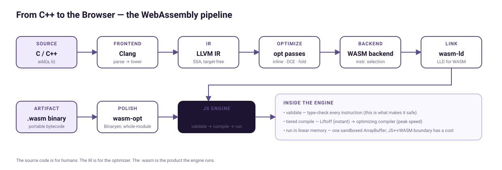

# From C++ to the Browser: The WebAssembly Compiler Pipeline

Slides and live demo for my talk at **[JSConf México 2026](https://www.jsconf.mx/en/agenda)**, Guadalajara, Thursday October 29, 12:30 on Stage B.

**Kyungtak Woo** · LLVM integration & release, Google Toolchains · [@kevinwkt](https://github.com/kevinwkt)

**Live demo:** https://kevinwkt.github.io/from-cpp-to-the-browser/demo/ · **Slides (PDF):** https://kevinwkt.github.io/from-cpp-to-the-browser/slides/From-Cpp-to-the-Browser-JSConfMX-2026.pdf

> WebAssembly is often described as "a faster JavaScript," but that description hides the most interesting part: the compiler pipeline that makes it possible. This talk follows one line of C++ through Clang, LLVM IR, the optimizer, the WebAssembly backend, the linker and Binaryen, and into V8. Then it turns to what it takes to run that pipeline for thousands of engineers.

## What's here

| Path | What it is |
|---|---|
| [`slides/`](slides/) | The deck as PDF (25 slides) A Spanish copy of the deck is in `slides/From-Cpp-to-the-Browser-JSConfMX-2026-ES.pptx`. |
| [`demo/`](demo/) | The live demo ([run it here](https://kevinwkt.github.io/from-cpp-to-the-browser/demo/)): a pipeline explorer over five C++ specimens, a Mandelbrot renderer compiled at -O0…-O3 and with SIMD raced against plain JavaScript, a JS ↔ WASM boundary lab, and a 64-bit integer race where JavaScript cannot tie. |
| [`NOTES.md`](NOTES.md) | The theory behind every stage and every demo beat, with sources |
| [`specimen/`](specimen/) | The one function the talk follows, with the real compiler output at every stage and a script to regenerate it |
| [`assets/`](assets/) | The pipeline diagram and demo screenshots |

## The specimen

```c
int add(int a, int b) { return a * 2 + b; }
```

| Stage | File | What to look at |
|---|---|---|
| Clang, no optimization | [`specimen/add-O0.ll`](specimen/add-O0.ll) | 9 instructions. Values live in memory (`alloca`/`store`/`load`), `a*2` is still a `mul`, and C++ mangled the name to `_Z3addii`. |
| LLVM `-O2` | [`specimen/add-O2.ll`](specimen/add-O2.ll) | 3 instructions. `mem2reg` removed the memory traffic; `instcombine` turned `mul 2` into `shl 1`. |
| WebAssembly | [`specimen/add.wat`](specimen/add.wat) | 5 stack-machine instructions: push `a`, push 1, shift, push `b`, add. |
| The binary | [`specimen/add.wasm`](specimen/add.wasm) | 258 bytes with this compiler, 209 stripped. The code section is 12 bytes; the rest is the type section, memory, two exports and a `producers` note naming the compiler. |

Regenerate everything (needs `clang` with the wasm32 target, `wasm-ld` and `wasm2wat`):

```bash
cd specimen && ./reproduce.sh
```

The slides trim the `noundef`, `align` and attribute annotations for readability. Nothing else is edited. The exact byte count of `add.wasm` moves with the compiler version because the `producers` section embeds its name.

## Running the demo

```bash
cd demo
./build.sh                    # optional: fractal.wasm is checked in
python3 -m http.server 8000   # .wasm must be served over http, not file://
# open http://localhost:8000 and click the fractal
```

Toolchain for `build.sh`:

- macOS: `brew install llvm lld wabt`, then `export CLANG="$(brew --prefix llvm)/bin/clang"` (Apple's clang has no WebAssembly backend; `lld` is a separate formula and provides `wasm-ld`).
- Linux: `sudo apt-get install clang lld wabt`.

No Emscripten, no libc, no libc++. `fractal.cpp` is compiled with `clang++ --target=wasm32 -nostdlib` at five optimization levels, and `index.html` loads them with one `fetch` and one `WebAssembly.instantiateStreaming` each. See [`demo/README.md`](demo/README.md).

## The pipeline



Source → Clang → LLVM IR → optimizer passes → WebAssembly backend → `wasm-ld` → `.wasm` → `wasm-opt` → the engine validates, compiles with Liftoff, and tiers hot functions up to the optimizing compiler.

## Further reading

- [WebAssembly specification](https://webassembly.github.io/spec/) and the [Wasm 3.0 announcement](https://webassembly.org/news/2025-09-17-wasm-3.0/)
- [V8: Liftoff, the baseline compiler](https://v8.dev/blog/liftoff) and [dynamic tiering](https://v8.dev/blog/wasm-dynamic-tiering)
- [V8: Emscripten and the LLVM WebAssembly backend](https://v8.dev/blog/emscripten-llvm-wasm)
- [LLVM's WebAssembly linker, wasm-ld](https://lld.llvm.org/WebAssembly.html)
- [Binaryen](https://github.com/WebAssembly/binaryen)
- [WASI 0.2](https://bytecodealliance.org/articles/WASI-0.2) and [WASI 0.3](https://wasi.dev/releases/wasi-p3)

## License

Code (`demo/`, `specimen/`) is under the [MIT License](LICENSE). Slides and images are © 2026 Kyungtak Woo; feel free to share them with attribution.
